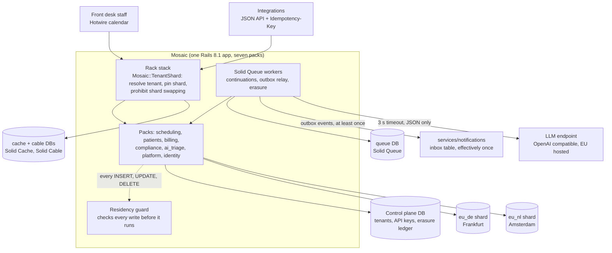
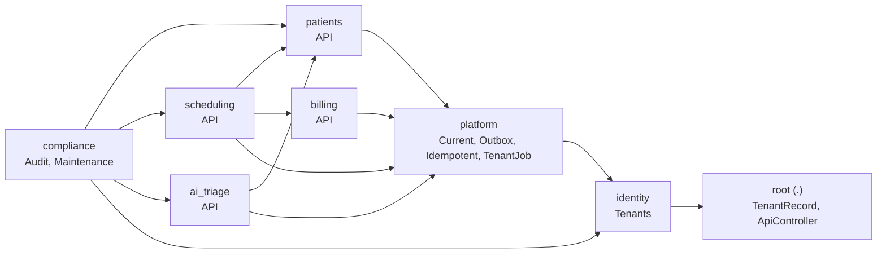
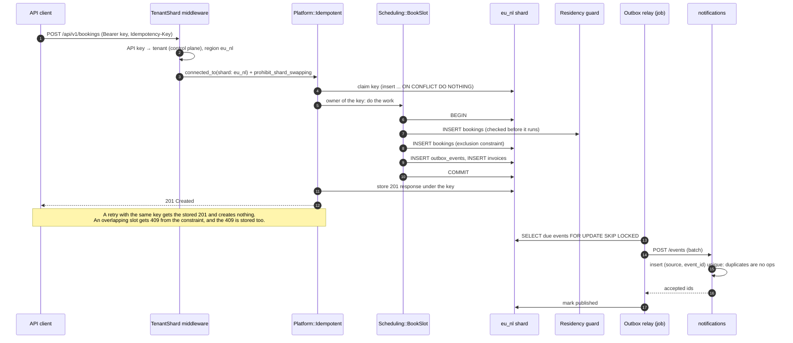
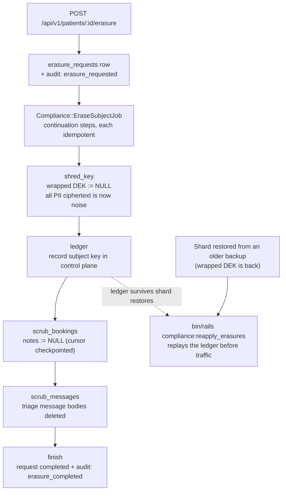
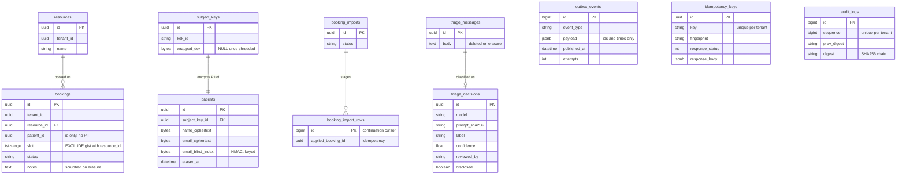
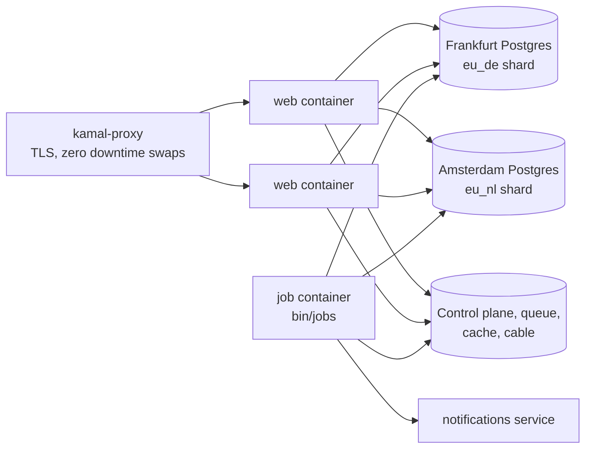

# Mosaic

**A multi tenant clinic scheduling platform that shows how to modernise a Rails monolith safely: enforced module boundaries, Rails 8 Solid infrastructure, resumable jobs, regional data residency, crypto shredding for GDPR erasure, and an AI triage feature with a real decision log.**

Ruby 3.4 · Rails 8.1 · Hotwire · Solid Queue / Cache / Cable · Packwerk · PostgreSQL 16 · Kamal 2

---

## Contents

1. [Why this exists](#why-this-exists)
2. [What it demonstrates](#what-it-demonstrates)
3. [Architecture](#architecture)
4. [Correctness and compliance guarantees](#correctness-and-compliance-guarantees)
5. [Failure model](#failure-model)
6. [Performance](#performance)
7. [Getting started](#getting-started)
8. [API](#api)
9. [Testing strategy](#testing-strategy)
10. [Modernisation path](#modernisation-path)
11. [Project layout](#project-layout)
12. [Verification status](#verification-status)
13. [Limitations and roadmap](#limitations-and-roadmap)

---

## Why this exists

Most European Rails teams are not starting new apps. They are living inside a large, valuable monolith and asked to make it safer to change while shipping features. In practice that means four things at once:

* draw boundaries inside the codebase before anyone says "microservices",
* get rid of fragile infrastructure (Sidekiq plus Redis, jobs that restart from zero on every deploy),
* keep each customer's personal data in the region its contract demands,
* honour GDPR erasure in a system where personal data has leaked into every table, cache, log and backup.

Mosaic is a complete, runnable system built around exactly those problems, in a domain where they bite: appointment booking for clinics in Germany and the Netherlands (the Doctolib and Fresha problem space).

## What it demonstrates

| Problem | Mechanism | Where |
| --- | --- | --- |
| Domains tangled inside one app | Seven packs with dependency and privacy checks; public APIs only; violation ratchet in CI | `packs/*/package.yml`, `bin/packwerk_ratchet`, [ADR 0001](docs/adr/0001-modular-monolith-before-services.md) |
| Double booking under concurrency | Postgres `EXCLUDE USING gist` on `(resource_id, slot)`; no check then insert race | `db/shard_migrate/…_create_scheduling.rb`, `Scheduling::BookSlot` |
| Client retries creating duplicates | `Idempotency-Key` with stored responses, fingerprint mismatch detection, crash takeover | `Platform::Idempotent`, `Platform::IdempotencyKey` |
| Side effects lost or sent for rolled back work | Transactional outbox in the same shard and transaction; `SKIP LOCKED` relay; idempotent consumer | `Platform::Outbox`, `Platform::OutboxRelay`, `services/notifications`, [ADR 0004](docs/adr/0004-transactional-outbox.md) |
| Deploys killing long jobs | Solid Queue + Active Job Continuations with checkpointed cursors, plus per row idempotency | `Scheduling::ImportBookingsJob`, [ADR 0005](docs/adr/0005-solid-queue-and-continuations.md) |
| Data must stay in Germany or the Netherlands | Horizontal shards per region; pinned requests and jobs; shard swapping prohibited; statement level residency guard | `Mosaic::TenantShard`, `Compliance::ResidencyGuard`, [ADR 0003](docs/adr/0003-regional-shards-and-residency-guard.md) |
| Erasing one person everywhere, backups included | Per subject envelope encryption, key destruction, erasure ledger replayed after restores | `Patients::Crypto::Envelope`, `Compliance::EraseSubjectJob`, [ADR 0002](docs/adr/0002-per-subject-envelope-encryption.md) |
| Tamper evident records | Hash chained audit log, append only trigger, nightly verification | `Compliance::AuditChain`, `Compliance::AuditLog` |
| Using an LLM responsibly | Timeout, strict output validation, safe fallback, human review queue, full decision log, disclosure | `AiTriage::Classifier`, [ADR 0006](docs/adr/0006-ai-triage-with-oversight.md) |
| First service extraction | Notifications extracted behind the outbox (strangler step); no PII crosses the boundary | `services/notifications` |

## Architecture

### System view



### Pack boundaries

Arrows point from a pack to the packs it may use. The graph is acyclic and checked in CI. Each pack exposes only what sits in its `app/public` folder.



### Booking a slot, end to end



### GDPR erasure, including backups



Crypto shredding on its own is a common half answer: a backup from before the erasure still contains the wrapped key. Mosaic records every shredded key in the control plane ledger, which has separate backups, and replays it after any shard restore. `erasure_test.rb` restores the key, replays the ledger and asserts the patient is erased again.

### Data model (regional shard)



`invoices` (unique per booking) and `erasure_requests` complete each shard. The control plane holds `tenants`, `api_keys` and `erasure_ledger`; Solid Queue, Solid Cache and Solid Cable each have their own database.

### Deployment



App containers are stateless and can run in either region; personal data at rest lives only in the regional databases.

## Correctness and compliance guarantees

| Guarantee | Enforced by | Verified by |
| --- | --- | --- |
| A resource is never double booked | Exclusion constraint on `(resource_id WITH =, slot WITH &&)` for non cancelled bookings | `book_slot_test.rb`, `concurrent_booking_test.rb` (20 threads, exactly 1 wins), `contention.js` (500 clients) |
| A retried POST does the work once | Unique `(tenant_id, key)` with stored response; body fingerprint | `idempotency_test.rb` |
| A booking, its event and its invoice commit together or not at all | One transaction in one shard; `Outbox.publish!` refuses to run outside a transaction | `book_slot_test.rb` |
| Every event is eventually delivered, and processed once | Relay retries with backoff; consumer inbox unique `(source, event_id)` | `outbox_relay_test.rb` |
| One invoice per booking | Unique index on `invoices.booking_id` + `insert … unique_by` | schema |
| Imports survive deploys without duplicates | Continuation cursor + `applied_booking_id` per row | `import_bookings_job_test.rb`, `scripts/deploy_under_load.sh` |
| Tenant data is written only to its region | Pinned shard, swap prohibition, guard before every write | `residency_test.rb`, `tenant_routing_test.rb` |
| Erasure covers copies, free text and restored backups | Key destruction, scrub steps, ledger replay | `erasure_test.rb` |
| Audit history cannot be rewritten silently | Append only trigger + hash chain | `audit_log_test.rb`, `test/pure/audit_chain_test.rb` |
| An LLM failure never mislabels silently | Strict validation, `needs_human` fallback, review queue | `classifier_test.rb` |
| Module boundaries do not erode | Packwerk dependency and privacy checks; ratchet | `bin/packwerk check`, `test/pure/packwerk_ratchet_test.rb` |

## Failure model

| Failure | Behaviour |
| --- | --- |
| Two clients race for the last slot | One `201`, the other `409 slot_taken`; the database decides |
| Client times out and retries | Same `Idempotency-Key` returns the stored response; a concurrent duplicate gets `409 request_in_progress` with `Retry-After` |
| Request crashed after claiming a key | The lock expires after 30 s and the next attempt takes over |
| Notifications service down | Events accumulate unpublished with backoff (max 5 min); nothing is dropped |
| Deploy during an import or erasure | Workers get SIGTERM; continuations checkpoint and resume on the new container |
| Code writes to the wrong region | Raises in dev and CI before the statement runs; reported in production |
| Unknown tenant or bad API key | `404 unknown_tenant` before any tenant table is touched |
| LLM slow, down or returning nonsense | `needs_human` fallback after 3 s, logged, routed to staff |
| Shard restored from an old backup | `compliance:reapply_erasures` re shreds every erased subject before traffic |
| Someone edits the audit table | Trigger refuses UPDATE, DELETE and TRUNCATE; nightly chain verification flags offline edits |

## Performance

Measured in the authoring sandbox (1 vCPU Intel Xeon 2.8 GHz, Ruby 3.2.3, OpenSSL 3.0.13):

| Operation | Result |
| --- | --- |
| Encrypt one PII field (AES 256 GCM with authenticated context) | **128,745/s** |
| Decrypt one PII field | **194,404/s** |
| Unwrap a subject key | 181,228/s |
| Verify a 20,000 entry audit chain | 925 ms |

Encryption is not the bottleneck: decrypting every name on a 40 booking calendar day costs about 0.2 ms.

Acceptance targets, with the command that measures each, are listed in [docs/BENCHMARKS.md](docs/BENCHMARKS.md): booking p99 under 150 ms at 300 req/s, exactly 1 winner out of 500 concurrent attempts, 0 lost or duplicated jobs across 50 deploys during a 100k row import, and erasure under 60 s.

## Getting started

### Prerequisites

Ruby 3.4, PostgreSQL 16, and optionally Docker and [k6](https://k6.io).

```bash
git clone https://github.com/ombdj1209/mosaic.git && cd mosaic
docker compose up -d postgres notifications   # Postgres + the extracted service
bin/setup                                      # gems, Solid schemas, 6 databases, seeds, server
```

`bin/setup` prints an API key per seeded tenant:

| Tenant | Region | Staff UI |
| --- | --- | --- |
| Kliniek Amstel | `eu_nl` (Amsterdam) | http://kliniek-amstel.localhost:3000 |
| Praxis an der Spree | `eu_de` (Frankfurt) | http://praxis-spree.localhost:3000 |

The calendar shows each practitioner's day as a timeline. Book from the form, or from the API in another terminal, and watch the block appear live over Solid Cable. Overlapping bookings are refused with a clear message.

### Useful commands

```bash
bin/ci                                    # the full local CI (config/ci.rb)
ruby test/pure/run.rb                     # crypto, audit chain, ratchet: no database needed
bin/rails test                            # Rails suite
bin/packwerk check && bin/packwerk_ratchet
bin/rails compliance:reapply_erasures     # after any shard restore
bin/rails compliance:verify_audit
```

## API

All endpoints take `Authorization: Bearer <api key>`. Every `POST` takes an `Idempotency-Key` header, which is required for bookings, patients, messages and erasures.

### Create a patient

```bash
curl -s localhost:3000/api/v1/patients \
  -H "Authorization: Bearer $KEY" -H "Idempotency-Key: $(uuidgen)" -H "Content-Type: application/json" \
  -d '{"patient":{"name":"Łukasz Wiśniewski","email":"lukasz@example.test"}}'
# 201 {"id":"…","name":"Łukasz Wiśniewski","erased":false}
```

### Book a slot

```bash
curl -s localhost:3000/api/v1/bookings \
  -H "Authorization: Bearer $KEY" -H "Idempotency-Key: booking-123" -H "Content-Type: application/json" \
  -d '{"booking":{"resource_id":"…","patient_id":"…","starts_at":"2027-01-15T10:00:00Z","ends_at":"2027-01-15T10:30:00Z"}}'
```

| Status | Meaning |
| --- | --- |
| `201` | Booked (a replay also returns `201`, with `Idempotent-Replayed: true`) |
| `409 slot_taken` | Overlaps an existing booking for that resource |
| `409 request_in_progress` | Same key is being processed right now; retry after `Retry-After` |
| `422` | Invalid times, unknown patient, or key reused with a different body |
| `400 idempotency_key_required` | Missing header |
| `404 unknown_tenant` | Bad or revoked API key |

`GET /api/v1/bookings/:id` reads a booking; `DELETE /api/v1/bookings/:id` cancels it and publishes `booking.cancelled`.

### Erase a patient

```bash
curl -s -XPOST localhost:3000/api/v1/patients/$PATIENT/erasure \
  -H "Authorization: Bearer $KEY" -H "Idempotency-Key: erase-$PATIENT"
# 202 {"erasure_request_id":"…","status":"pending"}
```

### Triage a message, then review it

```bash
curl -s localhost:3000/api/v1/messages -H "Authorization: Bearer $KEY" -H "Idempotency-Key: m1" \
  -H "Content-Type: application/json" -d '{"message":{"patient_id":"…","body":"Can I move Tuesday to Thursday?"}}'
# 202 {"message_id":"…","notice":"Your message was sorted by an automated assistant. …"}

curl -s -XPATCH localhost:3000/api/v1/triage_decisions/$DECISION -H "Authorization: Bearer $KEY" \
  -H "Content-Type: application/json" -d '{"decision":{"override_label":"reschedule","reviewed_by":"desk:anna"}}'
```

## Testing strategy

| Layer | Covers | Files |
| --- | --- | --- |
| Pure Ruby (no database) | Envelope encryption (tamper, wrong key, context binding, shredding), audit chain (edit, delete and forge detection), boundary ratchet | `test/pure/*` (17 tests) |
| Domain | Booking rules, outbox and invoice atomicity, half open ranges, cancellations | `test/scheduling/book_slot_test.rb` |
| Concurrency | 20 real threads racing for one slot, with real commits | `test/scheduling/concurrent_booking_test.rb` |
| Jobs | Continuation import applied exactly once across reruns; erasure end to end, idempotent, survives a restore | `import_bookings_job_test.rb`, `erasure_test.rb` |
| Platform | Idempotency replay, mismatch and missing key; outbox delivery, retry, partial acknowledgement | `test/platform/*` |
| Compliance | Residency guard (model writes, bulk writes, no tenant, swap prohibition); append only audit | `test/compliance/*` |
| AI | Confident, urgent, low confidence and failing model outputs | `test/ai_triage/classifier_test.rb` |
| HTTP | Tenant routing to the right region, unknown tenant, health check | `test/integration/*` |
| System | k6 load and contention, deploys under load | `loadtest/`, `scripts/deploy_under_load.sh` |

## Modernisation path

Mosaic ships in its end state; [docs/MODERNISATION.md](docs/MODERNISATION.md) is the stage by stage playbook for getting a real legacy monolith there without a feature freeze:

`v0 baseline` → `v1 boundaries` (packs, todo baseline, ratchet) → `v2 jobs` (Sidekiq to Solid Queue queue by queue, idempotency first, continuations, Redis removed last) → `v3 residency` (shards, backfill, dual write, guard in report mode) → `v4 extraction` (outbox first, shadow consumer, flip) → `v5 compliance` (subject keys, ledger, audit chain).

## Project layout

```text
app/                       base records (ApplicationRecord, TenantRecord), base controllers, layout, CSS
lib/mosaic/tenant_shard.rb tenant resolution and shard pinning middleware
lib/tasks/compliance.rake  reapply_erasures, verify_audit
packs/
  platform/      Current, Outbox (+ relay), Idempotent, TenantJob
  identity/      tenants, API keys (control plane)
  patients/      encrypted patients, subject keys, Envelope, KeyRing
  scheduling/    resources, bookings, BookSlot, continuation import, Hotwire calendar
  billing/       invoices, idempotent per booking
  compliance/    audit chain and log, erasure job and ledger, residency guard
  ai_triage/     messages, classifier, decision log, review endpoint
services/notifications/    extracted service: outbox consumer with an inbox table
db/migrate/                control plane      db/shard_migrate/   regional shards
config/ci.rb               Rails 8.1 local CI     config/deploy.yml   Kamal 2
docs/                      ADRs, modernisation playbook, benchmarks, compliance, runbook
loadtest/k6/, scripts/     load, contention, deploy under load
test/                      pure Ruby + Rails suites
```

## Verification status

Mosaic was written in a sandbox where rubygems.org was not reachable, so Rails could not be booted there. What **was** executed:

* `ruby -c` on all 93 Ruby and rake files, and a compile of all ERB templates (with Rails block helpers normalised): no errors.
* The 17 pure Ruby tests (encryption, audit chain, ratchet): all passing.
* A static audit standing in for `bin/packwerk check` and Zeitwerk eager loading: 54 autoloaded files map to the right constant names; 59 files show 0 undeclared dependencies and 0 private constant references; no dependency cycles. It caught and fixed a pack cycle, a private constant used across packs, a two constants per file layout, and an `api` inflection conflict.
* The crypto and audit chain benchmarks above.

On a machine with network access, `bin/setup` and then `bin/ci` run the full suite, including Packwerk, RuboCop, Brakeman and the database backed tests. That also generates `Gemfile.lock` and the `db/structure.sql` files.

## Limitations and roadmap

* Staff authentication is omitted; tenant comes from the subdomain. A production build would add Rails 8's authentication generator plus per tenant roles.
* KEKs come from environment variables locally; production should call a KMS from `Patients::KeyRing` (wrap and unwrap only, the DEK never leaves process memory).
* Name search over encrypted PII is not supported (exact email lookup only, via blind index).
* Next: per tenant rate limits on the API, OpenTelemetry spans across the outbox boundary, an encrypted search index for patient names, and a second extracted service (billing) once its boundary has been stable for a few months.

---

Built by **Om Prakash Bharadwaj** · MIT licence · design decisions in [docs/adr](docs/adr)
